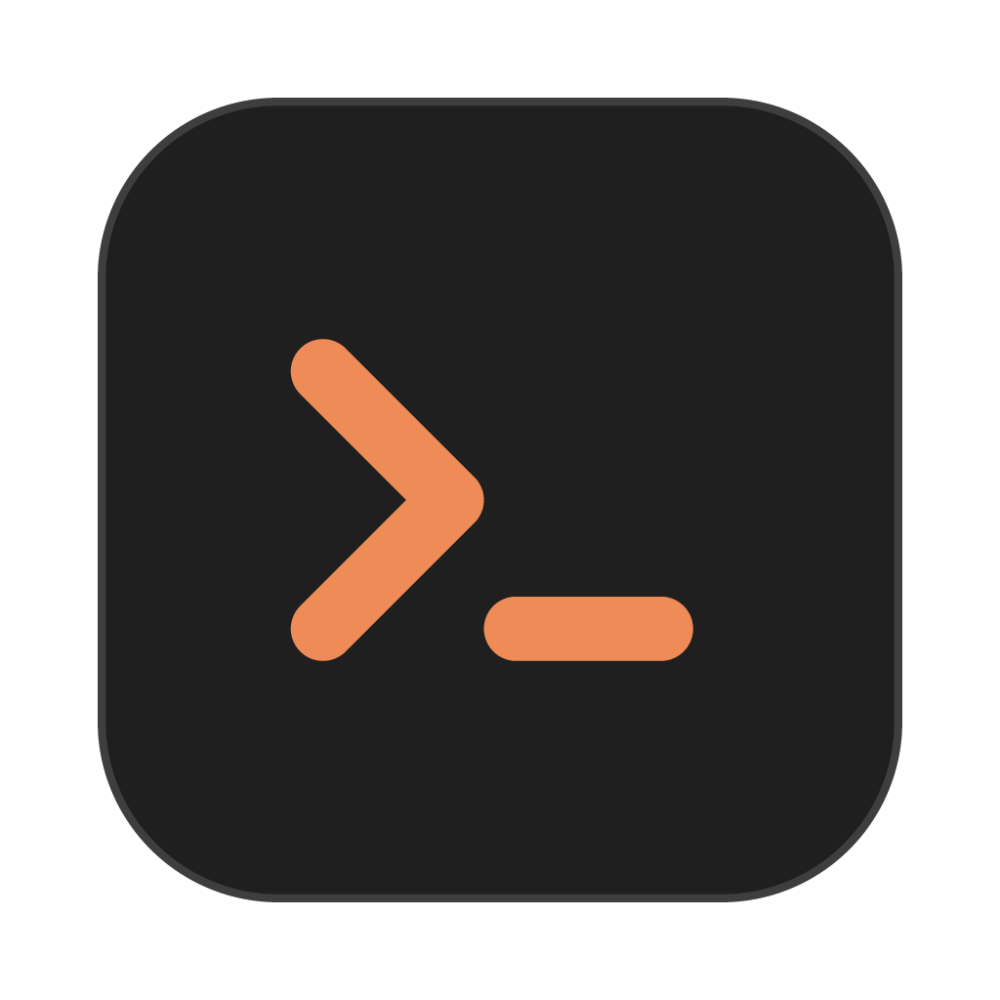
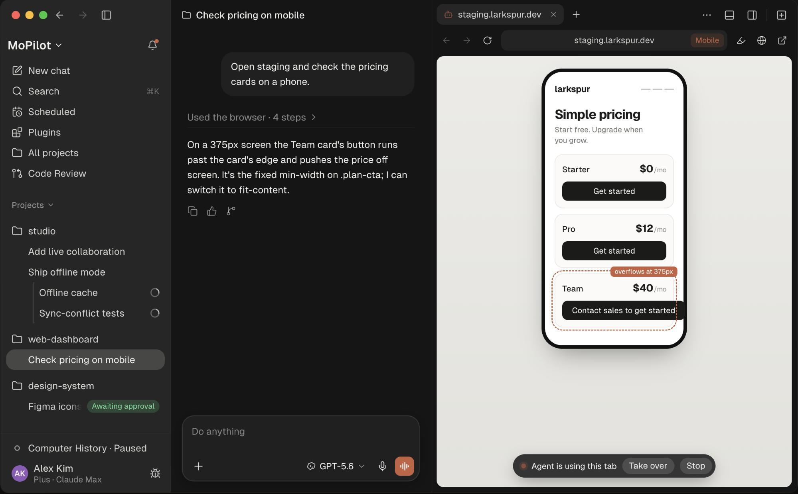
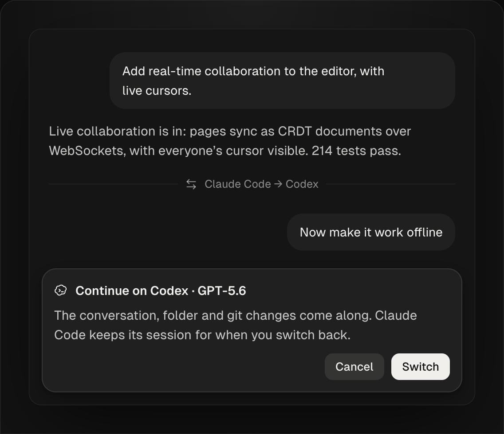
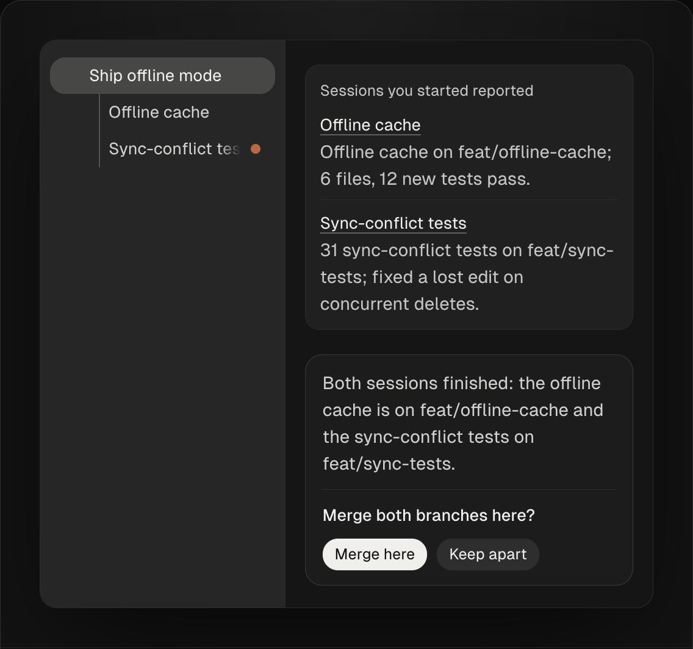
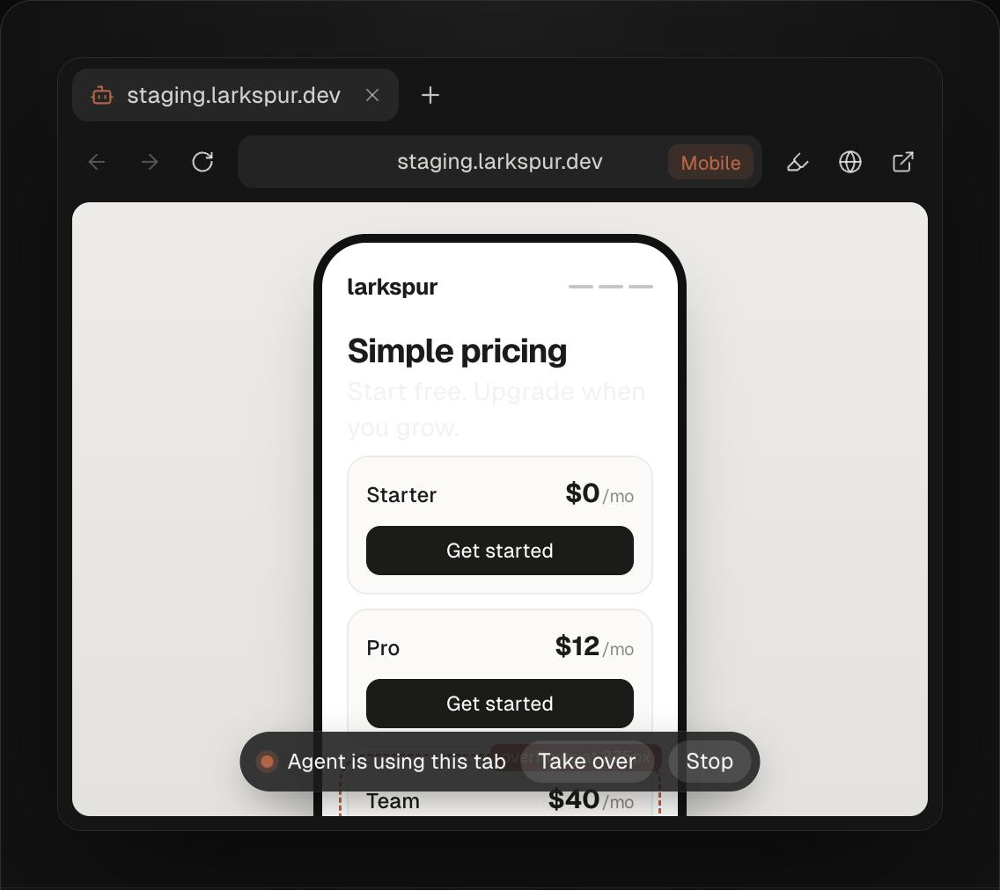
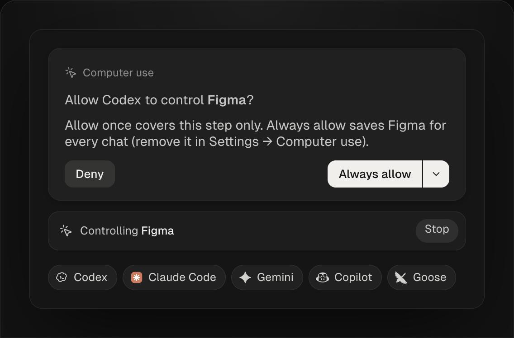
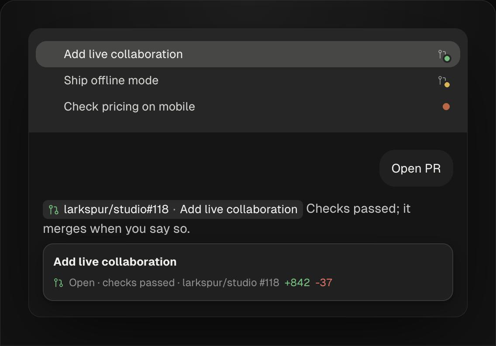
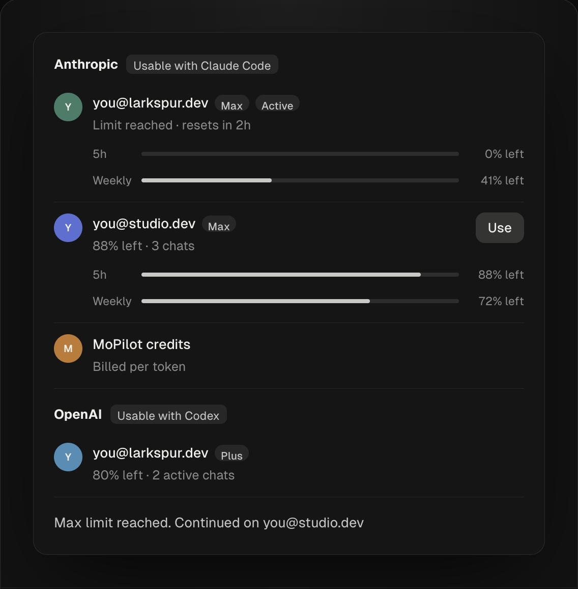

<h1 align="center">
  <a href="https://mopilot.ai"></a>
  <br />
  MoPilot
</h1>

<p align="center">
  <a href="https://github.com/mopilot-ai/mopilot/stargazers"></a>
  <a href="LICENSE"></a>
  <a href="https://mopilot.ai/discord"></a>
  
</p>

<h2 align="center">Your agents. One workspace.</h2>

<p align="center">
  Open source. Build with Codex, Claude Code, and 25+ more agents with your own agent credentials.<br />
  Switch agents mid-task. Work in parallel. Review everything together.
</p>

<h3 align="center">
  <a href="https://mopilot.ai/download">Download MoPilot</a>
  &nbsp;·&nbsp; <a href="https://mopilot.ai">Try the interactive demo →</a>
</h3>

<p align="center">
  <a href="https://mopilot.ai"></a>
  <br /><sub>Screenshots in this README are captures of the <a href="https://mopilot.ai">interactive demo</a> and use illustrative projects, accounts, and results.</sub>
</p>

MoPilot brings your coding agents, conversations, files, terminals, and browser into one desktop app.
Start with one agent, bring in another for a second opinion, or split independent work into linked
sessions with their own Git worktrees. Keep the project in view from the first prompt to the final diff.

## Features

### Change agents without starting over

Start a task with Claude Code, switch to Codex for a second opinion, or continue with another compatible
agent. Choose what context to carry over; the conversation, working folder, and Git changes stay
together.

<p align="center">
  
</p>

### Parallel work you can follow

Send independent tasks to linked sessions, each with its own agent and optional Git worktree.
Watch their progress in the sidebar, read their reports in the parent chat, and decide how to bring
the branches together.

<p align="center">
  
</p>

### A browser the agent can see

Open a local preview or website beside the chat. The agent can inspect and interact with the page
while you watch; you can annotate it, take over, or stop the action. Connect **Your Chrome** when
the task needs your existing browser session. [Browser guide →](docs/browser.md)

<p align="center">
  
</p>

### Computer use, with you in control

On macOS, agents can work in the desktop apps you allow. Approval cards name the app, an activity
strip shows what is happening, and **Esc** stops control.

<p align="center">
  
</p>

### Review and ship the change

Review highlighted diffs and send comments on specific lines back to the agent. Track pull request
checks and conflicts alongside the conversation. Turn on **Auto-fix** when you want the agent to
address failed checks and review feedback.

<p align="center">
  
</p>

### Accounts and usage in one place

Manage your Codex and Claude Code accounts, watch usage meters, and optionally switch subscriptions
when one reaches its limit. Switching to metered billing always asks first.

<p align="center">
  
</p>

### Run anywhere, check in from your phone

- **MoPilot Host** runs agents on a macOS or Linux machine without the desktop app. Connect from the Mac app over SSH or the relay and use its chats, files, and remote browser. Work continues while your laptop is closed. [Host setup →](docs/host.md)
- **Mobile Remote** is available for development: the phone client and the relay are both here. The source clients need a separate account integration for end-to-end phone pairing. [Mobile source →](mobile/README.md)
- **The relay** runs with your own token issuer; configure the clients that connect to it. [Relay setup →](docs/mobile-remote/self-hosting.md)

**Also in the box:**

- **Files, terminal, and previews:** diffs, documents, spreadsheets, slides, images, audio, and video beside the chat.
- **Steering for long tasks:** streaming replies, grouped tool steps, task lists, approvals, queued messages, and Stop.
- **[Plugins](docs/multi-harness/PLUGINS.md):** one page for skills and MCP integrations, with support mapped to each agent.
- **Scheduled tasks:** repeat useful work on any available agent, with an explicit policy for unattended approvals.
- **Dictation:** in every chat; voice conversation where the Codex chat and ChatGPT account support it.
- **Existing conversations:** your Codex and Claude Code chats appear without an import step.
- **Search, pins, and archive:** notifications, light and dark themes, and chats that reopen after a restart.
- **12 languages:** English, Deutsch, Español, Français, Bahasa Indonesia, Italiano, 日本語, 한국어, Português, Русский, 简体中文, and 繁體中文.

## Supported agents

**Codex** and **Claude Code** have native integrations: chat, tools, agent switching, account
management, and usage controls. Other agents connect through the
**[Agent Client Protocol](docs/native-acp-harnesses.md)** and share the workspace, browser tools,
approvals, and linked sessions.

<p align="center">
  <kbd>Codex</kbd> <kbd>Claude Code</kbd> <kbd>Cursor</kbd> <kbd>GitHub Copilot</kbd> <kbd>Gemini</kbd> <kbd>Antigravity</kbd>
  <kbd>Grok</kbd> <kbd>opencode</kbd> <kbd>Cline</kbd> <kbd>Goose</kbd> <kbd>Qwen Code</kbd> <kbd>Kimi Code</kbd>
  <kbd>DeepSeek dsh</kbd> <kbd>Devin</kbd> <kbd>Droid</kbd> <kbd>Kiro</kbd> <kbd>Kilo Code</kbd> <kbd>Auggie</kbd>
  <kbd>Autohand</kbd> <kbd>CodeBuddy</kbd> <kbd>Command Code</kbd> <kbd>Hermes Agent</kbd> <kbd>MiMo Code</kbd> <kbd>Mistral Vibe</kbd>
  <kbd>Muse</kbd> <kbd>oh-my-pi</kbd> <kbd>Prime Agent</kbd> <kbd>Qoder</kbd> <kbd>TRAE</kbd>
</p>

An ACP agent powers a chat once MoPilot has checked its installed version, sign-in, and protocol.
Models, attachments, and modes depend on the agent. **Settings → Other agents → Agent directory**
shows what works on your machine, and the [harness matrix](docs/harness-matrix.md) lists
capabilities per agent.

## Install

### Desktop: macOS, Windows, Linux

- **[Download from mopilot.ai](https://mopilot.ai/download)**: macOS for Apple silicon or Intel, Windows x64, and Linux x64 or ARM64.
- Or with [Homebrew](https://brew.sh) on macOS:

```bash
brew install --cask mopilot-ai/tap/mopilot
```

Then:

1. **Connect your agent.** Open **Settings → Harnesses** to detect or install a CLI and sign in. A *harness* is the agent runtime that powers a chat.
2. **Open a project and give it a task.** Choose a folder or a Git worktree, pick an agent and model, and set its permissions.

A useful first task:

> Map this project's architecture and find one small improvement. Explain your plan before editing.
> After I approve, make the change, run the relevant tests, and show me the diff.

Coming from Conductor? [Import your workspaces in place](https://mopilot.ai/conductor).

### Host and phone

Set up [MoPilot Host](docs/host.md) on another machine from the Mac app. The
[phone client](mobile/README.md) builds from this repository for development.

## Build from source

You need **Node.js 24**, npm, Git, and the Rust toolchain pinned in
[`core/rust-toolchain.toml`](core/rust-toolchain.toml). On macOS, install the Xcode Command Line
Tools; on Linux, see the [Linux guide](docs/linux.md).

```bash
git clone https://github.com/mopilot-ai/mopilot.git
cd mopilot
npm ci
npm --prefix mobile ci
npm run dev
```

`npm run dev` builds the Rust core and native helpers when needed, then starts the app. The
[development guide](docs/development.md) covers toolchains, running a second instance, packaging,
and troubleshooting. For Chrome integration,
[load the extension from your checkout](electron/chrome-extension/) while running the app from source;
the official app owns registration of the Chrome Web Store extension.

| Directory | What it holds |
| --- | --- |
| [`electron/`](electron/) | Main process, agent adapters, browser and computer tools, accounts, and background services. |
| [`src/`](src/) | React interface, chat state, and the typed native bridge. |
| [`shared/`](shared/) | Cross-process contracts and [agent descriptors](shared/harnesses/). |
| [`core/`](core/) · [`native/`](native/) | Rust core and native platform helpers. |
| [`host/`](host/README.md) · [`relay/`](relay/README.md) | Headless agent runtime and pairing relay. |
| [`mobile/`](mobile/README.md) · [`electron/chrome-extension/`](electron/chrome-extension/) | Phone client and the Chrome extension. |
| [`tests/`](tests/) | Unit tests. |

### What runs outside this repository

The desktop app, Host, relay, phone client, and Chrome extension are all here. The MoPilot website,
account service, model gateway, and product analytics are hosted services and are not. A build from
source uses no-op analytics, and features that need a MoPilot account (credits, the hosted relay)
need those services configured. Everything you do with your own agent credentials works without
them. [Architecture →](docs/architecture/modularization.md)

## Contributing

Issues and pull requests are welcome. [CONTRIBUTING](.github/CONTRIBUTING.md) walks from a clone to
a merged pull request, [AGENTS.md](AGENTS.md) holds the working rules people and coding agents
share, and everyone follows the [code of conduct](.github/CODE_OF_CONDUCT.md). Before you push:

```bash
npm run test:related -- --direct <changed-files>
npm run test:coverage -- --changed --related
npm run lint
npm run typecheck
npm run module-map -- --check
```

## Questions

<details>
<summary><strong>Can I use my existing agent accounts?</strong></summary>

Use the sign-in or API credentials supported by your chosen agent under its provider's terms. For Claude Agent
SDK integrations, use an Anthropic Console API key or supported cloud provider. Consult Anthropic's
[authentication guidance](https://code.claude.com/docs/en/legal-and-compliance) for use of the local Claude Code binary.

</details>

<details>
<summary><strong>Can I self-host it?</strong></summary>

The Host and relay are in this repository, along with the desktop and phone clients. The MoPilot
account service and model gateway are not. A phone build trusts the relay it was built for, so an
independent deployment builds its own clients. See the
[self-hosting guide](docs/mobile-remote/self-hosting.md).

</details>

<details>
<summary><strong>What about privacy?</strong></summary>

Model requests go to the agent provider you choose. The relay carries encrypted device messages, not
plaintext chats. A build from source sends no product analytics; the downloadable app's defaults are
on its [privacy page](https://mopilot.ai/privacy).

</details>

<details>
<summary><strong>Does the browser share my Chrome sign-in?</strong></summary>

The built-in browser has its own cookies and sign-ins. Use its sign-in flow, import from your
browser, or connect **Your Chrome** to work in your existing Chrome session.
[Browser details](docs/browser.md).

</details>

## Community and support

- **[Discord](https://mopilot.ai/discord):** ask questions and talk to the team.
- **[Issues](https://github.com/mopilot-ai/mopilot/issues/new/choose):** report a bug or request a feature. In the app, you can also use **Report a bug**.
- **[Support](https://mopilot.ai/support):** account, pairing, and download help for the official app.
- **[Security](.github/SECURITY.md):** report vulnerabilities privately.
- **[Documentation](docs/README.md):** architecture, guides, and design notes.
- **Show support:** star the repository.

## License

MoPilot is open source. Its code in this repository is licensed under [Apache-2.0](LICENSE). See [NOTICE](NOTICE)
and the [third-party notices](docs/THIRD-PARTY.md) for attribution and applicable third-party terms, and the
[trademark policy](TRADEMARKS.md) for using the MoPilot name and artwork.
